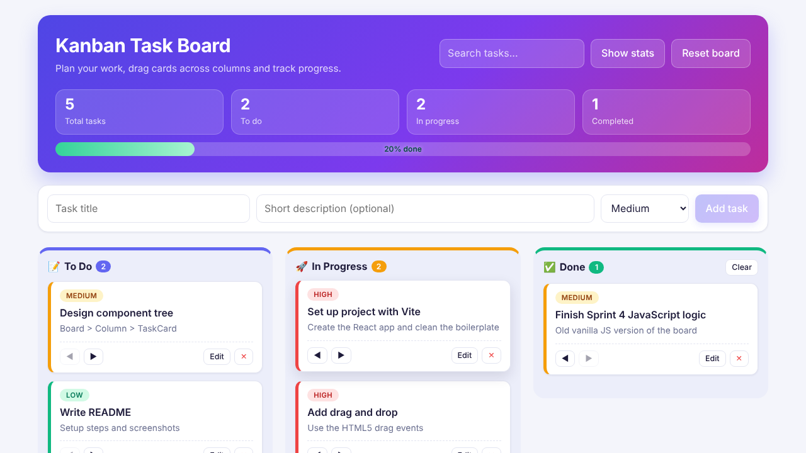

# Kanban Task Board (Sprint 5 - React Migration & State Architecture)

A Kanban board built with React. It is the React version of my earlier vanilla JavaScript task board.
Tasks can be dragged between **To Do**, **In Progress** and **Done**, and everything is saved in
`localStorage`, so the board is still there after a refresh.



## Features

- Component tree: `App` > `Board` > `Column` > `TaskCard` (plus `AddTaskForm` and `RenderStats`)
- Drag and drop with the native HTML5 drag events (no library), including reordering inside a column
- Arrow buttons on each card as a fallback for touch screens and keyboard users
- Add, edit and delete tasks, set priority (High / Medium / Low)
- Search box to filter tasks
- Header with task counts and a progress bar (percentage of tasks completed)
- State handled with `useReducer`, saved to `localStorage` after every change
- `React.memo`, `useMemo` and `useCallback` so that only the components that changed re-render
- Optional "Show stats" panel that counts renders so you can see the memoization working
- Responsive layout (3 columns on desktop, stacked on mobile)

## Tech stack

React 19, Vite, plain CSS. No other runtime libraries.

## Setup

Requirements: Node.js 18 or newer.

```bash
npm install
npm run dev        # development server, http://localhost:5173
npm run build      # production build in /dist
npm run preview    # preview the production build
npm test           # unit tests for the reducer (node's built-in test runner)
```

## Project structure

```
src/
  App.jsx                    common ancestor, owns the board state (useBoard) and ui state
  main.jsx                   entry point
  index.css                  all styles
  components/
    Board.jsx                renders the 3 columns
    Column.jsx               drop zone, search filter, list of cards
    TaskCard.jsx             one draggable card (edit / delete / move)
    AddTaskForm.jsx          form to create a task
    RenderStats.jsx          dev panel with render counters
  hooks/
    useBoard.js              useReducer + localStorage + stable action callbacks
    useRenderCount.js        small helper that counts renders of a component
  reducer/
    boardReducer.js          all state transitions (add, edit, delete, move, clear, reset)
    boardReducer.test.js     unit tests
    initialData.js           default tasks and column order
  renderStats.js             tiny store used by the stats panel
```

## How it works

### Phase 1 - Component structure and state lifting
`Board`, `Column` and `TaskCard` are separate components. The board state lives in `App`
(through the `useBoard` hook) because it is the closest common ancestor of the form, the board
and the stats panel. Data goes down as props and actions go up as callbacks.
Each card handles its own drag events, so `Board` and `Column` do not pass any drag handlers
through several levels.

### Phase 2 - Drag and drop
- `TaskCard` is `draggable` and stores its id in `dataTransfer` on `dragstart`.
- `Column` listens to `dragover` / `drop`. While dragging it works out which card the dragged card
  would be placed above (by comparing the mouse position with the middle of each card) and shows a line there.
- On drop, a `MOVE_TASK` action is dispatched. The reducer removes the task from the old column and
  inserts it in the new one.
- The `useEffect` in `useBoard` writes the new state to `localStorage` right after every change.
- The "dragging" style is added with `classList` directly on the DOM node so React does not have to
  re-render anything just to fade the card.

### Phase 3 - useReducer and memoization
- `boardReducer` handles `ADD_TASK`, `EDIT_TASK`, `DELETE_TASK`, `MOVE_TASK`, `CLEAR_DONE` and `RESET_BOARD`.
  Columns that are not touched by an action keep the same object reference.
  A drop on the exact same spot returns the old state, so nothing re-renders.
- `Board`, `Column`, `TaskCard` and `AddTaskForm` are wrapped in `React.memo`.
- All handlers passed down (`addTask`, `moveTask`, ...) are created with `useCallback` and depend only
  on `dispatch`, which never changes, so their identity is stable.
- `Column` uses `useMemo` to filter its tasks, so it only recalculates when its tasks or the search text change.

## Proving there are no unnecessary re-renders

1. Run `npm run dev` and open the app.
2. Click **Show stats**, then **Reset counters**.
3. Drag one card from To Do to In Progress.
4. Look at the panel: `Board` 1, `Column todo` 1, `Column inprogress` 1 to 2 (the extra one is the drop
   line while hovering), the **Done** column is not listed (0 renders) and only **one** TaskCard rendered
   (the moved card, which is mounted again in its new column). The other cards stay at 0.

You can also confirm it in the React DevTools Profiler: record, drag a card, stop. The Done column and
all the untouched cards are greyed out ("did not render"). In dev mode the stats panel also shows the
timing reported by React's `<Profiler>` for the board.

## Deployment

- **Vercel / Netlify**: import the GitHub repo, build command `npm run build`, output directory `dist`.
- **GitHub Pages**: `vite.config.js` already uses `base: './'`, so the content of `dist` can be published directly.

## Known limitations

- HTML5 drag and drop does not fire on touch devices, that is why the arrow buttons exist.
- Data is stored only in the browser (`localStorage`), there is no backend.
